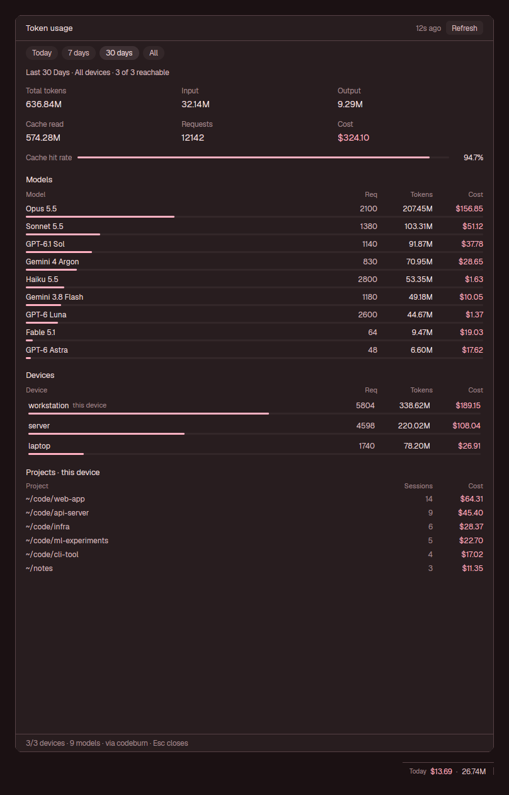

# herdr-codeburn-usage

A [Herdr](https://herdr.dev) mod that shows what your coding agents cost, on every machine
you use, in one place.



- **Status bar:** a small item shows today's cost and tokens, added up across all your
  devices. Hover it for a per-device breakdown.
- **Dialog:** click the item or press `ctrl-shift-u` to open it, and press either again (or
  Esc) to close it. It covers Today, 7 days, 30 days or All:
  - totals: total tokens, input, output, cache read, requests and cost
  - cache hit rate
  - every model, merged across devices, with its requests, tokens and cost
  - each device's share. Click a device to see only its numbers.
  - the projects on this machine
- **Fast to open:** numbers are cached per range, so the dialog opens with data at once and
  refreshes in the background when they are more than a minute old.

The data comes from [codeburn](https://github.com/getagentseal/codeburn). It already reads
the usage logs of Claude Code, Codex, Cursor, Copilot, OpenCode and other agents, prices them
per model, and can pull usage from your other machines. The mod runs one
`codeburn status --scope combined --combined-details` per refresh and indexes nothing itself.

## Requirements

- **[Herdr Desktop App](https://herdr.dev)** (`herdr-app`).
- **[codeburn](https://github.com/getagentseal/codeburn)** 0.9 or newer on the machine running
  Herdr: `npm i -g codeburn`.
- **On every other device you want included,** codeburn installed and sharing its usage:
  1. On that device, run `codeburn share --pair`. It prints a PIN.
  2. On the machine running Herdr, run `codeburn devices add`, which finds nearby devices. To
     add one by address instead, run `codeburn devices add <host> --pin <PIN>`.
  3. On that device, run `codeburn share --always` so it keeps sharing.

  Without paired devices, the mod shows this machine on its own.

## Install

### With your agent

Ask the coding agent you use in Herdr:

> Read ~/.config/herdr-app/AGENTS.md, then add this mod: https://github.com/Lungooo/herdr-codeburn-usage/tree/main/codeburn-usage

Herdr's `~/.config/herdr-app/AGENTS.md` tells agents how to add a mod:
- read the recipe and files first;
- copy `mods/codeburn-usage/` into place;
- merge `keys.json` into yours, asking before replacing a key you already use;
- run `herdr-app check`.

It also explains how to put the status item into a copy of your layout.

### Manually

1. Copy the mod into Herdr's mods folder. Copy `mod.json` first: if Herdr sees `main.js`
   without it, it docks the mod into your layout as a panel of its own.

   ```sh
   git clone https://github.com/Lungooo/herdr-codeburn-usage
   mkdir -p ~/.config/herdr-app/mods/codeburn-usage
   cp herdr-codeburn-usage/codeburn-usage/mods/codeburn-usage/mod.json ~/.config/herdr-app/mods/codeburn-usage/
   cp herdr-codeburn-usage/codeburn-usage/mods/codeburn-usage/*.js ~/.config/herdr-app/mods/codeburn-usage/
   herdr-app check ~/.config/herdr-app/mods/codeburn-usage
   ```

2. Add the key to the `"global"` section of `~/.config/herdr-app/keys.json`:

   ```json
   "ctrl-shift-u": "mod.open:codeburn-usage"
   ```

   The dialog now opens with `ctrl-shift-u`, or with `herdr-app do mod.open '{"name":"codeburn-usage"}'`.

3. Optional, for the status-bar item: add a block to your layout's status row. Herdr's shipped
   layouts are read-only, so clone one first
   (`herdr-app do layout.clone '{"name":"main","as":"my-main"}'`). Then add this block to the
   row that holds your status bar in `~/.config/herdr-app/layouts/my-main.json`:

   ```json
   { "id": "status-codeburn", "type": "block",
     "content": { "mod": "codeburn-usage", "props": { "bar": true } },
     "size": { "px": 160 } }
   ```

   The item resizes its block to fit its text. If you give the block another id, add it to
   the props: `"props": { "bar": true, "block": "<your id>" }`.

See [`codeburn-usage/RECIPE.md`](codeburn-usage/RECIPE.md) for how the mod behaves and how it
is built.

## License

MIT
