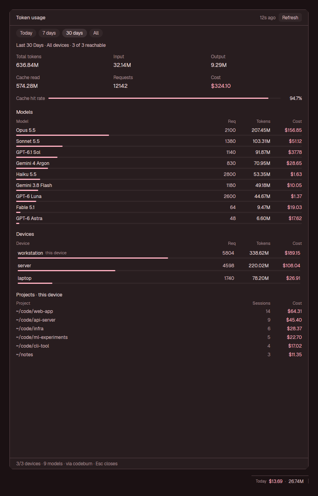

# Codeburn usage

What your coding agents have spent, on every machine you use, in one place. A small item
in the status bar shows today's cost and tokens, added up across all your paired devices.
Clicking it (or `ctrl-shift-u`) opens a dialog for Today, 7 days, 30 days or All: totals,
cache hit rate, every model merged across devices, each device's share, and this device's
projects. The numbers come from [codeburn](https://github.com/getagentseal/codeburn), which
already indexes Claude Code, Codex, Cursor, Copilot, OpenCode and others and can pull usage
from your other machines. The panel itself indexes nothing.



## What you see

**Status-bar item.** One line on the theme's `chrome`, with a 1 px `border` line on top like
the rest of the bar, text 11.5 px in `muted`:

- 11 px left padding, then a dim 10 px `Today`, the cost (`done` when above zero, else `dim`),
  a dim `·`, and the total tokens (`52.23M`). Elements are 6 px apart.
- When a paired device can't be reached, `N offline` follows in `blocked`.
- 11 px after the text comes a 1 px × 12 px `border` separator on the item's right edge, so it
  reads as its own section next to whatever follows.
- The item sizes its own block to its text, so there is no gap after it.
- Before the first answer it shows `…`. If codeburn fails it shows `codeburn unavailable` in
  `blocked`.
- When its numbers are over 3 minutes old, the whole item drops to 60% opacity.
- Hovering shows a tooltip with one line per device (`server: $75.95 · 161.22M`, or
  `unreachable (<error>)`) and `Click for details (ctrl-shift-u)`.

**Dialog.** 760 px wide and 85% of the window tall, centered, in Herdr's dialog frame. It has a
`surface` background and `foreground` text. Top to bottom:

- **Header,** 40 px, 16 px side padding, 1 px `border` line under it:
  - `Token usage` at 13 px semibold
  - a right-aligned 11.5 px `dim` stamp that counts up: `just now`, `12s ago`, `3m ago`,
    `2h ago`, `4d ago`, or `refreshing · 44s ago` while a refresh runs
  - a `Refresh` pill, 22 px tall, 9 px padding, radius 6, `raised` background with `muted`
    text; on hover, `hover` background with `foreground` text
- **Range chips,** 16 px side padding, 8 px above and below, 6 px apart: `Today`, `7 days`,
  `30 days`, `All`. Each is 22 px tall, 10 px padding, radius 11, 11.5 px text.
  - The chosen chip is `selected` with `foreground` text and turns `accent` on hover.
  - The others are `raised` with `muted` text and turn `selected`/`foreground` on hover.
  - All four show a pointer cursor.
- **Scroll area,** 16 px side padding, 10 px between blocks, ending in a 12 px bottom pad:
  - **Scope line,** 11.5 px in `muted`: `Last 30 Days · All devices · 3 of 3 reachable`, or
    one device's name with `(this device)` for the local one. While narrowed to one device,
    an `All devices` pill at the right resets it.
  - **Six tiles** in two rows of three, 16 px apart: `Total tokens`, `Input`, `Output` /
    `Cache read`, `Requests`, `Cost`. Each is an 11.5 px `dim` label over a 14 px value.
    `Cost` is `done` when above zero. Values truncate rather than wrap.
  - **Cache hit rate:** the label, a 3 px rounded bar (track `raised`, fill `accent`) and a
    46 px right-aligned percentage with one decimal.
  - **Models:**
    - A 12.5 px semibold title. It reads `Models · top 12 of N` when there are more than 12.
    - A header row in 11 px `dim`: `Model`, `Req`, `Tokens`, `Cost`, the three numbers in
      fixed 56 / 84 / 76 px right-aligned columns.
    - Up to 12 rows at 12 px: the name truncates; requests in `muted`, tokens (`1.24M`,
      `128k`, `2.4k`), cost in `done`.
    - Under each row, a 3 px `accent` bar as wide as the model's share of the tokens shown.
    - Models are merged by codeburn's display name across the chosen devices and sorted by
      tokens. With none: `No model data in this range`.
  - **Devices:** the same columns, one row per paired device, local first.
    - The local device carries a dim 11 px `this device` tag.
    - Each row has a 3 px `accent` bar for its share of the reachable devices' tokens.
    - An unreachable device shows `unreachable: <error>` in `blocked` instead of numbers.
    - Rows have 4 px padding and radius 4. The chosen row is `selected`; others turn `hover`
      on hover.
  - **Projects · this device:**
    - A header row: `Project`, `Sessions` (one 140 px column), `Cost`.
    - Up to 10 rows, 20 px tall: the folder with your home written as `~` (in `muted`,
      truncating), the session count, and the cost.
    - Only shown for all devices or the local one, since codeburn never shares project rows
      between devices. Empty: `No project data in this range`.
- **Footer,** 28 px, 1 px `border` line above, one truncating 11.5 px line: `3/3 devices ·
  3 models · via codeburn · Esc closes`, or the last error in `blocked`.

Every color comes from `theme()` by name, so it follows light and dark themes. Bars are
the only graphics. Nothing animates.

## How it behaves

- **Opening and closing.** Clicking the status item and `ctrl-shift-u` both run
  `mod.open codeburn-usage`, and both toggle: a second press closes the dialog. Esc closes it,
  and so does a click outside it. Only one dialog is ever open.
- **Shared choices.** The range and the chosen device are shared state
  (`codeburn-usage.range`, `codeburn-usage.device`), so they are remembered across opens and
  restarts. Clicking a device row narrows everything to it; clicking it again, or `All
  devices`, widens it back.
- **Where numbers come from.** Each range's last codeburn answer is cached in shared state
  (`codeburn-usage.cache.<period>`), trimmed to what the dialog draws.
  - The dialog opens with the cached numbers at once.
  - It runs codeburn only when that range is over 60 s old, when you pick another range, or on
    Refresh. Refresh always runs codeburn, even with fresh numbers.
- **Background refresh.** The status item checks every 15 s and refreshes Today when it is
  over 60 s old, so opening the dialog on Today rarely waits.
  - It pauses while the dialog is open, so nothing redraws underneath it.
  - The pause lasts at most 5 minutes after the dialog opened, in case the dialog's close was
    missed.
- **The stamp** redraws only when its text changes: every second for the first minute, then
  every minute, then every hour. Nothing else in the dialog redraws on a timer.
- **States:**
  - The dialog shows `Asking codeburn…` the first time a range has no cache yet.
  - It shows `codeburn failed: <message>` if codeburn can't run.
  - A failed refresh keeps the last numbers and says so in the footer:
    `Refresh failed, showing 3m ago: <message>`.
- **Agent statuses** (working, blocked, done, idle) aren't drawn. The theme's `done` and
  `blocked` colors are only used for cost and for errors.

## Built from

- **`mods/codeburn-usage/mod.json`:**
  `{"place":"none","title":"Token usage","overlay":{"kind":"dialog","width":760,"height":0.85}}`.
  The dialog is what `mod.open` opens. The status item is the same mod placed in a layout
  block with `props: {"bar": true}`.
- **`mods/codeburn-usage/store.js`.** Plain logic with no imports, so Node can run it to
  check numbers:
  - `RANGES` (`today`, `week`, `30days`, `lifetime`, with their chip labels)
  - `codeburnArgs`
  - `parsePayload`: tolerates a warning line before the JSON
  - `slim`: keeps only what `summarize` reads, about 2–8 KB instead of 50–150 KB
  - `devicesOf` and `summarize`: totals, merged models, devices and projects for one device
    id or `all`
  - the formatters `fmtTokens`, `fmtCount`, `fmtCost`, `fmtAgo` and `tildify`
- **`mods/codeburn-usage/main.js`:** the View. `isBar()` picks the status item or the dialog;
  then come the refresh logic, the toggle and the drawing.
- **Data source.** One program, run through `exec`:
  `codeburn status --format menubar-json --scope combined --combined-details --period
  <today|week|30days|lifetime> --no-optimize --no-timeline`. It takes 0.7–1.2 s and prints
  50–150 KB.
  - `--scope combined` adds `combined.perDevice`: per-device totals (cost, calls, sessions,
    input, output, cache create, cache read, total) and `combined.combined`.
  - `--combined-details` adds `combinedDevices[]`, one per device with its own payload. Each
    keeps `current.topModels`, uncapped and with token counts. Projects, sessions and branches
    are stripped from remote payloads by codeburn itself.
  - The local `current` carries `topProjects`, `label` and `currency`.
  - All costs are USD; `currency.rate` and `currency.symbol` convert them for display.
  - If `codeburn` isn't on Herdr's PATH, it retries through the login shell
    (`$SHELL -lic 'codeburn …'`).
- **`herdr` functions:**
  - `exec`, `theme`, `shared` / `setShared`, `props`, `home`, `closeOverlay`
  - `run("mod.open", {name})` for the status item's click
  - `run("layout.resize", {id: props().block ?? "status-codeburn", px})` for its width,
    measured with `on_size_change` on its content
  - `props().overlay`, to tell its own dialog apart
- **`keys.json`:** `{"global": {"ctrl-shift-u": "mod.open:codeburn-usage"}}`.

### Install

1. Copy `mods/codeburn-usage/` into `~/.config/herdr-app/mods/`, writing `mod.json` first
   (see Watch out). Merge `keys.json` into yours, and ask before replacing a `ctrl-shift-u`
   that's already bound.
2. Put the status item in your layout's status row, for example between a system block and a
   quota block:

   ```json
   { "id": "status-codeburn", "type": "block",
     "content": { "mod": "codeburn-usage", "props": { "bar": true } },
     "size": { "px": 160 } }
   ```

   The 160 px is only a start; the item resizes its block to fit its text. If you give the
   block another id, pass it as `"props": { "bar": true, "block": "<id>" }`. Shipped layouts
   are read-only, so clone one first (`herdr-app do layout.clone '{"name":"main","as":"mine"}'`).
3. Without a status row, the dialog still works from `ctrl-shift-u` on its own.

## Watch out

- **Redraws are expensive while the dialog is open.** With it open, each whole-window redraw
  took 0.5–1 s on the machine this was built on; with it closed, 7–100 ms. Running codeburn and
  parsing its output don't block the UI thread (`exec` measured clean); the redraws do. That
  is why:
  - the dialog has no clock, only the stamp, which redraws as rarely as its text changes;
  - a refresh redraws once, when it finishes;
  - the status item pauses while the dialog is open.

  A 15 s "keep it fresh" `cx.notify()` in the dialog made the window freeze in a regular
  rhythm. A restart of Herdr made things smoother, but keep the design.
- **Don't cache on disk with `fs/promises`.** Here it is slow, and a read on open showed an
  empty dialog for 1–2 s with the window frozen. The cache lives in `shared()`, which is in
  memory and saved by Herdr.
- **`frames()` can't drive the count-up stamp.** Every view shares one clock, so the list
  doesn't start at your timestamp. Use a timer that fires only when the text will change.
- **Measure the status item; don't estimate it.** A width from character count × 0.62 em left
  a visible gap in a proportional font. Measure the content with `on_size_change` and resize
  the block to width + 23 (11 + 11 + 1).
- **`close()` is best-effort.** If it doesn't run (for example when Herdr quits with the dialog
  open), the open mark stays. That's why the pause expires after 5 minutes, why the status item
  clears the mark when it starts, and why a stale mark only costs one extra key press.
- **Toggle mechanics.** On open, a dialog reads `codeburn-usage.dialog-open` (`{id, at}`). If
  another id is there, it closes that one and itself and clears the mark. Otherwise it writes
  its own id. Only the dialog whose id is in the mark clears it on close.
- **Write `mod.json` before `main.js`.** A folder Herdr sees without `"place": "none"` gets
  docked into the shown layout as a column on its own.
- **Some themes give `hover` the same color as `raised`.** The chips use `selected` for hover
  so it stays visible.
- **codeburn's period names:** `all` means the last 6 months, so `All` uses `lifetime`.
  `week` means the last 7 days.
- **What it assumes about the setup:**
  - codeburn 0.9.x is installed (`npm i -g codeburn`).
  - Other devices are paired with `codeburn share --pair` there and `codeburn devices add`
    here. Without paired devices it shows this machine alone, as one device.
  - Remote devices that can't be reached within codeburn's 8 s fetch timeout show as
    unreachable for that refresh.
- **Limits:** 12 models, 10 projects, a 60 s freshness window, and a 5-minute maximum pause.

## Done when

- `herdr-app check ~/.config/herdr-app/mods/codeburn-usage` prints `check passed`.
- With the status block in the shown layout, `herdr-app shot` shows `Today $… · …M` with a
  separator after it, and no gap before the next item.
- `herdr-app do mod.open '{"name":"codeburn-usage"}'` opens the dialog. Running it again closes
  it: `herdr-app status` lists no overlays. Running it three times leaves exactly one
  `codeburn-usage` overlay.
- After the dialog has shown a range once, closing and reopening it shows that range's numbers
  in the first frame, with a stamp like `12s ago` and no `Asking codeburn…`.
- The numbers check out against codeburn. The models merged by `store.js` add up to codeburn's
  own combined total:

  ```sh
  codeburn status --format menubar-json --scope combined --combined-details --period 30days \
    --no-optimize --no-timeline > /tmp/cb.json
  node --input-type=module -e "
    import {summarize} from '$HOME/.config/herdr-app/mods/codeburn-usage/store.js';
    import fs from 'fs';
    const p = JSON.parse(fs.readFileSync('/tmp/cb.json','utf8')), s = summarize(p, 'all');
    console.log(s.models.reduce((a,m) => a + m.cost, 0).toFixed(2), p.combined.combined.cost.toFixed(2));"
  ```

  The two printed costs are equal.
- `codeburn devices --format json -p 30days` lists the same devices as the dialog's Devices
  section on 30 days. Remote costs are identical. The local device can be slightly higher if an
  agent session is still running between the two reads.
